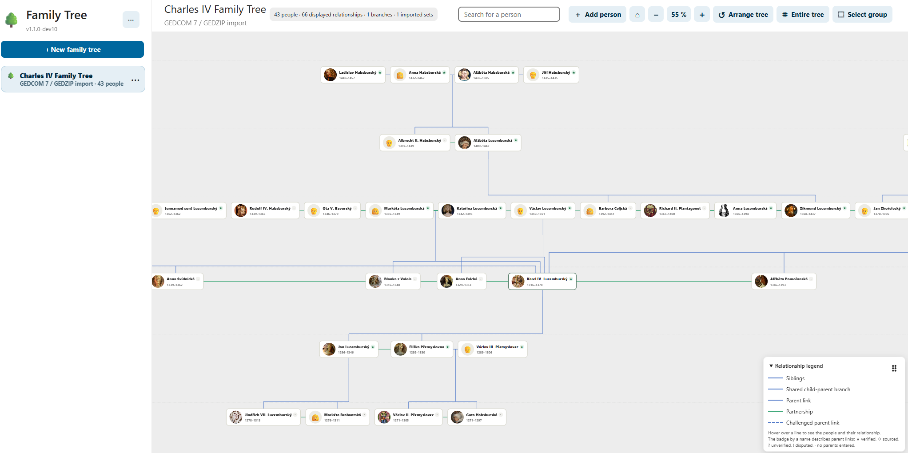

# FamilyTree 1.1.5 for Nextcloud

[Česky](README_CZ.md) · [Installation](docs/en/01_INSTALLATION.md) · [Import, export and backup](docs/en/IMPORT_EXPORT_BACKUP.md) · [Changelog](CHANGELOG.en.md)

**FamilyTree** is a self-hosted genealogy application for **Nextcloud 35**. Create and share family trees, people, relationships and events; manage photos, sources, documents and research notes; import GEDCOM 7 / GEDZIP; and keep your records in your own Nextcloud.



## Installation — recommended for all users

**Install the official, signed release through Nextcloud's Apps interface**, not from this GitHub source archive:

1. In Nextcloud, sign in as an administrator and go to **Apps**.
2. Install and enable **Hacesoft Shared App Core** (`hc_shared_app_core`) version **0.18.8 or later**.
3. Find **FamilyTree** (`hc_familytree`) in the app catalog, choose **Download and enable**, and open it in the navigation menu.
4. For subsequent updates, use Nextcloud's app-update mechanism and back up the database and files before upgrading.

App Store: https://apps.nextcloud.com/apps/hc_familytree

The release published to the Nextcloud App Store is distributed as a **cryptographically signed TAR.GZ archive**. Nextcloud downloads and validates it as part of the supported installation workflow. The public **full-source.zip** contains source files and is **not** the signed installable application. Do not upload a plain, unsigned runtime TAR.GZ as an official release.

## Requirements

- Nextcloud **35** (the compatibility range currently declared in `src/appinfo/info.xml`)
- PHP/runtime compatible with the installed Nextcloud server
- Hacesoft Shared App Core (`hc_shared_app_core`) **0.18.8+**, installed and enabled

## Development and testing only

The repository includes `install.sh` for a **specific Docker/Synology-style deployment** with accessible Nextcloud containers. It is **not** the default installer for end users, not a general Linux installer, and not a substitute for signed App Store releases.

From an extracted *complete source* checkout located **outside** `custom_apps`, a developer/tester can run:

```sh
sudo sh install.sh
```

The script deploys `src/` into the selected Nextcloud containers, checks the Core dependency, validates code and schema, and can change the application's installation and database structures. Back up your database and files first. Do not use it just to update an App Store installation without understanding the custom deployment workflow. See [developer/test installation and recovery](docs/en/01_INSTALLATION.md).

`uninstall.sh` is likewise a **developer/administrator tool** for these Docker layouts, not the recommended uninstall method. Ordinary users should manage installation and removal through Nextcloud Apps.

## Features

- Interactive family trees, pan/zoom, person and relationship editing, events and notes
- GEDCOM 7 (`.ged`) and GEDZIP (`.gdz`) import, and a versioned native ZIP backup and restore
- Documents, photographs, source citations and a research journal with tasks, searches and evidence
- Sharing with Nextcloud users and permission-aware access
- Responsive UI with English as default/fallback, Czech and nine other locale catalogs
- **Merge research findings** into an existing family tree using a ZIP bundle with GEDZIP, a research-journal JSON, and archive scans. Preview and explicitly approve all changes before importing; existing people and facts are not overwritten.

## Data and documentation

- [Import/export formats and data ownership](docs/en/03_DATA.md)
- [Backup and restore (native ZIP v2 vs. GEDCOM)](docs/en/IMPORT_EXPORT_BACKUP.md)
- [Research journal JSON interchange](docs/en/RESEARCH_JOURNAL_FORMAT.md)
- [Shared App Core integration](docs/en/02_CORE.md)
- [App Store screenshots](docs/en/APPSTORE_SCREENSHOTS.md)

A native FamilyTree ZIP backup is distinct from GEDCOM exchange. Keep independent backups of the Nextcloud database and stored files before major updates.

## Repository and release artifacts

The **public GitHub source ZIP** contains `src/` (the complete runnable app), public `docs/`, screenshots, license, changelogs and source deployment/build scripts. It intentionally excludes private keys, credentials, internal HDS/CP21 audit evidence, runtime logs and test reports.

`sh build-release.sh` assembles an **unsigned runtime ZIP** (`release/hc_familytree-1.1.5.zip`) for Publisher CP21, an **unsigned staging TAR.GZ**, and exactly one clean **`release/hc_familytree-1.1.5-full-source.zip`** from this checkout; the build **does not sign or publish** a release. The release manager uses Hacesoft Publisher to run mandatory quality gates, sign the application with the registered Nextcloud certificate, and publish the final TAR.GZ and its archive signature to the App Store. The signed final artifact is not produced by this GitHub source ZIP alone.

**License:** [AGPL-3.0-or-later](LICENSE). Report problems via [GitHub Issues](https://github.com/hacesoft/FamilyTree/issues).

**New in 1.1.5:** [Import research findings into an existing tree](docs/en/IMPORT_FINDINGS_INTO_EXISTING_TREE.md).
