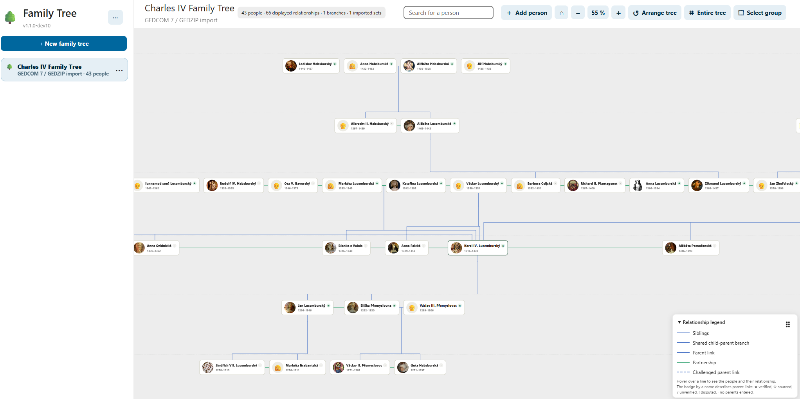

# Rodokmen (FamilyTree) 1.1.4 pro Nextcloud

[English](README.md) · [Instalace](docs/cz/01_INSTALACE.md) · [Import, export a záloha](docs/cz/IMPORT_EXPORT_ZALOHA.md) · [Změny](CHANGELOG.cs.md)

**Rodokmen / FamilyTree** je genealogická aplikace pro vlastní **Nextcloud 35**. Spravuje rodokmeny, osoby, vztahy, události, fotografie, dokumenty, prameny a výzkumný deník. Podporuje import GEDCOM 7 / GEDZIP a sdílení s uživateli Nextcloudu.



## Doporučená instalace — pro běžné uživatele

**Primární a doporučený způsob je instalace oficiálního podepsaného vydání přímo z katalogu Aplikace v Nextcloudu.** Neinstalujte běžně aplikaci ze zdrojového ZIPu na GitHubu.

1. Přihlaste se do Nextcloudu jako správce a otevřete **Aplikace**.
2. Nejdříve nainstalujte a povolte **Hacesoft Shared App Core** (`hc_shared_app_core`) verze **0.18.8 nebo novější**.
3. Vyhledejte **FamilyTree (Rodokmen)**, zvolte **Stáhnout a povolit** a otevřete aplikaci z navigace.
4. Další aktualizace provádějte pomocí správy aplikací Nextcloudu; předem zálohujte databázi a soubory.

Nextcloud App Store: https://apps.nextcloud.com/apps/hc_familytree

Oficiální vydání zveřejněné v Nextcloud App Storu je **kryptograficky podepsaný archiv TAR.GZ**. Nextcloud jej stáhne a ověří v rámci správy aplikací. Veřejný **full-source.zip** slouží ke zveřejnění kompletních zdrojových kódů, **není podepsaným instalačním balíčkem**. Nepublikujte nepodepsaný TAR.GZ jako oficiální vydání.

## Požadavky

- Nextcloud **35** (rozsah kompatibility uvedený v `src/appinfo/info.xml`)
- PHP a prostředí podporované nainstalovaným Nextcloudem
- Povolená aplikace Hacesoft Shared App Core (`hc_shared_app_core`) **0.18.8+**

## Pouze pro vývojáře a testery

Součástí zdrojů je `install.sh` pro **konkrétní prostředí Docker/Synology** s přístupnými kontejnery Nextcloudu. **Není určen pro běžné uživatele**, nejde o univerzální linuxový instalátor ani o alternativu podepsaného vydání z App Storu.

Vývojář nebo tester může celý zdrojový projekt rozbalit **mimo** `custom_apps` a v jeho kořeni spustit:

```sh
sudo sh install.sh
```

Skript nasazuje obsah `src/` do kontejnerů, kontroluje závislosti, verzi, PHP a databázovou strukturu; instalace může měnit aplikační kód a doplňovat databázové schéma. **Předem zálohujte databázi a soubory.** Pro správu standardní instalace z App Storu tento skript běžně nepoužívejte. Podrobnosti a obnova po chybě: [instalace pro testery](docs/cz/01_INSTALACE.md).

Také `uninstall.sh` je specializovaný nástroj pro vývojáře/správce v tomto Docker prostředí. Běžná odinstalace se provádí ve správě aplikací Nextcloudu.

## Funkce

- Interaktivní rodokmeny: posouvání, přibližování, osoby, příbuzenské vztahy, události a poznámky
- Import GEDCOM 7 (`.ged`), GEDZIP (`.gdz`); **nedestruktivní import badatelských nálezů do existujícího rodokmenu** (ZIP + průvodce + deník + důkazy); vlastní úplná záloha a obnova ZIP
- Fotografie, dokumenty, prameny, citace a badatelský deník s úkoly, hledáním a důkazy
- Sdílení s kontrolou přístupových práv uživatelů Nextcloudu
- Responzivní rozhraní a katalogy 11 jazyků; výchozí jazyk a záložní překlad jsou anglické

## Data a dokumentace

- [Údaje a výměnné formáty](docs/cz/03_DATA.md)
- [Vlastní ZIP v2 a obnova vs. GEDCOM](docs/cz/IMPORT_EXPORT_ZALOHA.md)
- [Formáty importu a exportu](docs/cz/FORMATY_IMPORT_EXPORT.md)
- [Import nálezů do existujícího rodokmenu](docs/cz/IMPORT_NALEZU_DO_STAVAJICIHO_RODOKMENU.md)
- [Shared App Core](docs/cz/02_CORE.md)
- [Obrázky pro App Store](docs/cz/OBRAZKY_APPSTORE.md)

Vlastní úplná záloha FamilyTree ZIP není totéž co výměnný formát GEDCOM. Vedle záloh aplikace udržujte i nezávislou zálohu databáze a souborů Nextcloudu.

## Struktura repozitáře a vydávání

Veřejný **GitHub zdrojový ZIP** obsahuje `src/` s úplnou aplikací, veřejné návody v `docs/`, obrázky, licenci, changelogy a potřebné instalační a sestavovací skripty. Záměrně neobsahuje soukromé klíče, konfigurace, interní HDS/CP21 auditní podklady, provozní logy ani testovací protokoly.

Příkaz `sh build-release.sh` vytvoří **nepodepsaný běhový ZIP** (`release/hc_familytree-1.1.4.zip`) požadovaný Publisherem CP21, **nepodepsaný přípravný TAR.GZ** a právě jeden čistý zdrojový archiv **`release/hc_familytree-1.1.4-full-source.zip`**. **Sám nic nepodepisuje ani nezveřejňuje.** Teprve Hacesoft Publisher provede závazné kontroly, podepíše aplikaci certifikátem Nextcloudu a připraví finální TAR.GZ včetně podpisu archivu pro Nextcloud App Store.

**Licence:** [AGPL-3.0-or-later](LICENSE). Chyby hlaste přes [GitHub Issues](https://github.com/hacesoft/FamilyTree/issues).
